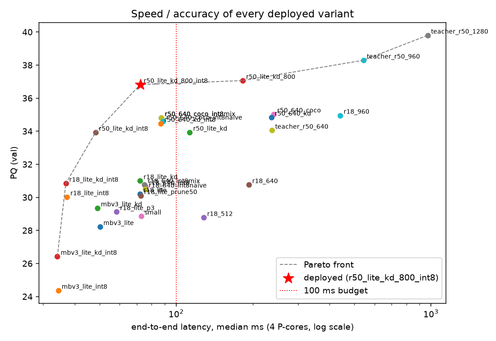
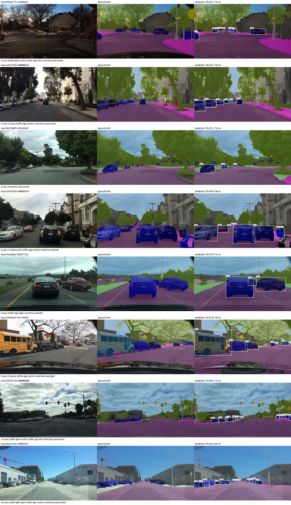

# RoadSight

Panoptic scene parsing for dashcam frames with **one two-headed model**, trained on BDD100K and then
**measured down to a CPU budget**. Background ("stuff": road, sidewalk, building, vegetation, sky, poles,
traffic lights/signs, …) is labelled per pixel; countable objects ("things": cars, pedestrians, riders,
trucks, buses, trains, motorcycles, bicycles) get a box, a number (`car #1`, `car #2`) and their own
pixels. A short rule-based summary describes the scene.

```
image -> backbone (ResNet / MobileNetV3) -> FPN -+- P3..P7 -> FCOS head      -> boxes (8 thing classes)
                                                 +- P2..P5 -> semantic head  -> 19-class pixel map
                              box-guided fusion (each box claims its own-class pixels) -> panoptic map
```

Results, the experiment log and the reasoning behind every choice are in
[`docs/REPORT.ka.md`](docs/REPORT.ka.md) (Georgian) and [`results/summary.md`](results/summary.md)
(all tables, generated). The original proposal is [`docs/PROPOSAL.ka.md`](docs/PROPOSAL.ka.md); how AI tools
were used is in [`docs/AI_USAGE.ka.md`](docs/AI_USAGE.ka.md).

## Results

val split (998 images). Latency: end-to-end median on an i9-14900KF, 4 threads pinned to 4 performance cores.

| model | runtime | PQ | mAP | mIoU | mIoU thin | latency | file |
|---|---|---|---|---|---|---|---|
| teacher: ResNet-50, 1280×720 | PyTorch FP32 | 39.8 | 28.2 | 58.1 | 49.9 | 1310 ms | 137 MB |
| deployed network, 800×450 | PyTorch FP32 | 37.1 | 21.0 | 58.7 | 44.5 | 304 ms | 103 MB |
| same | ONNX Runtime FP32 | 37.1 | 21.0 | 58.7 | 44.5 | 182 ms | 104 MB |
| same | ONNX Runtime INT8 | 36.8 | 21.0 | 58.5 | 44.3 | 72 ms | 27 MB |
| **`models/roadsight_int8.onnx`** (INT8 + fusion tuned on holdout) | ONNX Runtime INT8 | **37.0** | 21.0 | 58.5 | 44.3 | **73 ms** | 27 MB |

The deployed network is a ResNet-50 with slim heads (128-channel FPN, 2-conv FCOS towers), distilled from the
teacher. It is 18× faster than the teacher for −2.8 PQ; the loss falls on small and thin objects (AP_S 17.1 → 8.3).
The working point was chosen by a rule fixed before measuring: highest PQ within 100 ms. Nothing reached 33 ms
without a large accuracy drop, so this is not called real-time.





## Repository layout

| path | what |
|---|---|
| `roadsight/model.py` | backbone + FPN, FCOS head, semantic head, `DeployModel` (the exported inference graph) |
| `roadsight/fcos.py` | FCOS target assignment (centre sampling, scale ranges) and losses (focal, GIoU, centerness) |
| `roadsight/postprocess.py` | NMS, box-guided panoptic fusion, scene summary, colour overlay (numpy only) |
| `roadsight/metrics.py` | mIoU, panoptic quality (PQ/SQ/RQ, panopticapi rules), COCO box AP |
| `roadsight/engine.py` | training loop (multi-task loss, uncertainty weighting, distillation, pruning) and GPU evaluation |
| `roadsight/data.py`, `labels.py` | dataset, multi-scale batch sampler; label reading / panoptic ground truth |
| `roadsight/scoring.py` | per-image scoring shared by PyTorch and ONNX evaluation |
| `configs/` | experiment configs (`base.yaml` + overrides); `queue.yaml` is the full experiment queue |
| `tools/` | data preparation, training, evaluation, ONNX export, quantisation, CPU benchmark, analysis, report |
| `app/` | FastAPI demo + web page (ONNX Runtime, no PyTorch) |
| `tests/` | unit tests for metrics, fusion, FCOS targets, model shapes, and a GT-through-fusion check |

## Setup

Python 3.11+. Install PyTorch for your platform first (https://pytorch.org), then:

```bash
pip install -r requirements.txt
```

## Data

The official ETH download mirror no longer resolves (checked October 2026). `prepare_data.py` fetches the
19-class semantic masks from the Berkeley mirror and the images + instance bitmasks (with original file
names) from the Hugging Face dataset `adhisetiawan/bdd10k-bitmasks`, keeps the images present in both
(6,996 train / 998 val), holds out 500 training images for tuning, derives boxes from the bitmasks and
writes EDA statistics to `data/bdd10k/stats.json`.

```bash
python tools/prepare_data.py --download
```

Data is under the BDD100K license (non-commercial research and education).

## Training

```bash
python tools/train.py configs/r18_lite.yaml                       # one experiment
python tools/train.py configs/r18_lite.yaml name=x train.seed=1   # any field can be overridden
python tools/run_queue.py queue.yaml --slots 3                    # the whole experiment queue, resumable
```

Each run writes `runs/<name>/{config.yaml, train_log.csv, model.pt, metrics.json}`; metrics are on the
500-image holdout and the 998-image val split. The deployed model is `runs/r50_lite_kd_800` (trained with
`queue.yaml`, after `teacher_r50`). `configs/small.yaml` (slim ResNet-18, 12 epochs) is the reduced config for a free
GPU; [`notebooks/reproduce_small.ipynb`](notebooks/reproduce_small.ipynb) runs it on Kaggle/Colab (its T4 run time
has not been measured).

Experiment tracking: `python tools/log_to_mlflow.py` imports every run and evaluation into an MLflow store
(`mlruns/`); view it with `pip install mlflow && mlflow ui --backend-store-uri ./mlruns`.

## Evaluation and analysis

```bash
python tools/evaluate.py runs/r18_lite --split val                  # PQ, mAP, mIoU, per class
python tools/evaluate.py runs/r18_lite --split val --size 512 288   # another input size
python tools/tune_fusion.py runs/r18_lite --out results/fusion_r18_lite.json
python tools/error_analysis.py runs/r18_lite --out results/analysis/r18_lite
python tools/fusion_oracle.py                                         # upper bound of the fusion rule
```

## Optimisation and CPU deployment

```bash
python tools/export_onnx.py runs/r50_lite_kd_800 --size 800 450 --out models/r50_lite_kd_800.onnx
python tools/quantize.py models/r50_lite_kd_800.onnx --skip-fp16  # INT8, INT8 with FP32 last layers, naive INT8
python tools/onnx_eval.py models/r50_lite_kd_800_int8.onnx         # accuracy of the exported model on CPU
python tools/benchmark.py models/*.onnx --threads 4 --cpus 0 2 4 6
bash tools/run_ladder.sh          # the whole ladder, then the deployed model (fusion tuned on holdout)
python tools/visualize.py models/roadsight_int8.onnx   # input | ground truth | prediction -> results/samples/
python tools/make_report.py       # tables + figures -> results/
```

Latency protocol: ONNX Runtime CPU, batch 1, 4 threads pinned to four performance cores, 20 warm-up frames
then 200 val frames; median and p90 of preprocessing + model + post-processing (NMS, fusion, summary).
`--cpus 0 2 4 6` fits a hybrid Intel CPU where logical CPUs 0–15 are performance-core threads; on other machines
pick one thread per physical core. `benchmark.py` refuses to add results measured with different settings to an
existing file.

FP16 is not part of the results: converting the ResNet-50 models with `onnxconverter_common` took 17 GB of RAM.

## Demo

```bash
ROADSIGHT_MODEL=models/roadsight_int8.onnx uvicorn app.main:app --port 8000   # http://localhost:8000
docker build -t roadsight . && docker run --rm -p 8000:8000 roadsight
```

`POST /predict` (multipart `file`) returns objects, summary, timings and a base64 overlay;
`POST /predict/image` returns the overlay JPEG; `GET /health`.

The demo and API were tested locally with uvicorn. The Docker image's contents (exactly the files the Dockerfile
copies, `requirements-serve.txt` only, no PyTorch) were tested in a clean virtual environment; `docker build` itself
has not been run yet, because Docker Desktop failed to start on the development machine.

## Tests

```bash
pytest -q tests
```
