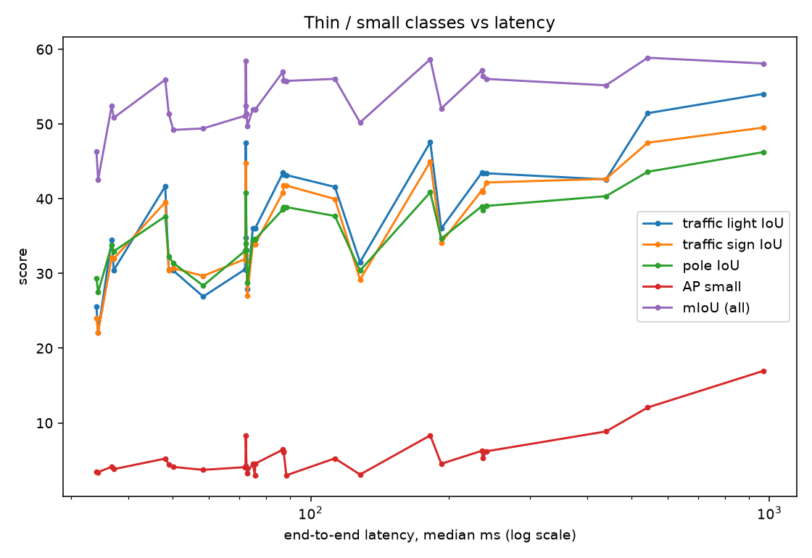
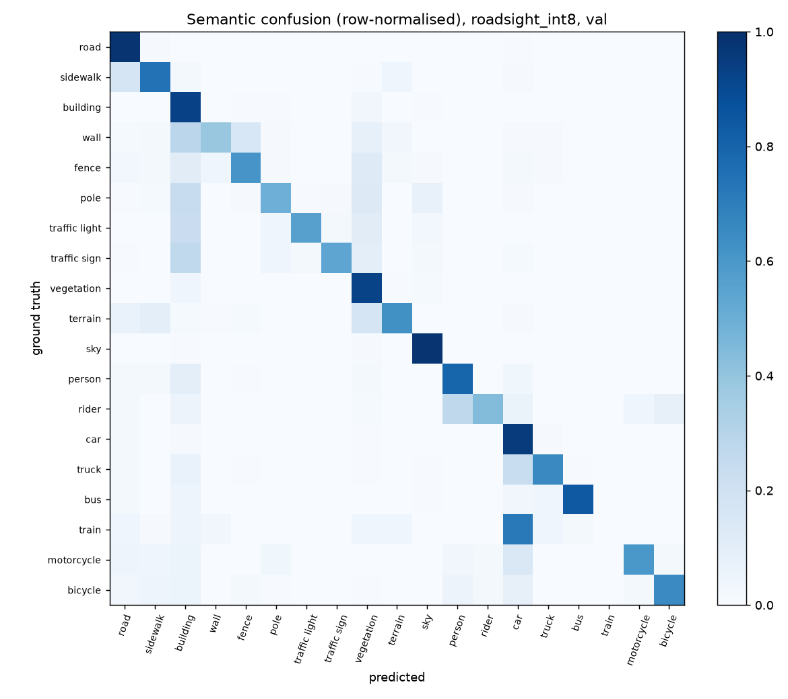

# RoadSight — ტექნიკური ანგარიში

> dashcam-ის კადრის პანოპტიკური აღწერა ერთი ორთავიანი მოდელით, გაზომილ CPU ბიუჯეტზე.
> ყველა ციფრი ამ დოკუმენტში მოდის `results/` და `runs/*/metrics.json` ფაილებიდან; სრული ცხრილები —
> [`results/summary.md`](../results/summary.md) (გენერირდება `tools/make_report.py`-ით).

## მოკლედ

- **რა:** dashcam-ის კადრის პანოპტიკური აღწერა — 11 ფონის კლასი პიქსელებად, 8 ითვლადი კლასი ცალკე ეგზემპლარებად
  და მოკლე ტექსტური შეჯამება — ერთი ორთავიანი მოდელით, GPU-ს გარეშე.
- **შედეგი:** გაშვებული მოდელი (ResNet-50 + მსუბუქი head-ები, teacher-იდან დისტილირებული, 800×450, ONNX INT8):
  **val PQ 37.0, 72 ms** (median, 4 CPU ბირთვი) — 100 ms ბიუჯეტში. teacher: PQ 39.8, 1310 ms →
  **18-ჯერ სწრაფი, −2.8 PQ**.
- **იგივე ქსელი, მხოლოდ deployment:** PyTorch 304 ms → ONNX 182 ms → INT8 72 ms (**4.2×**), PQ 37.1 → 37.0,
  ფაილი 104 → 27 MB.
- **ვინ იხდის ფასს:** პატარა და თხელი ობიექტები (ველოსიპედი, მოტოციკლი, ბოძი, ნიშანი, ფეხით მოსიარულე,
  შუქნიშანი: −6…−15 PQ teacher-თან შედარებით). დიდი ფონის კლასები უცვლელია. დანაკარგი ამოცნობაშია (RQ), არა ჭრის
  ხარისხში (SQ).
- **რა არ გამოვიდა:** „real-time" (≤ 33 ms) ხარისხის შენარჩუნებით; MobileNetV3 INT8-ზე ტყდება; 50% pruning CPU-ზე
  არ აჩქარებს; FP16 CPU-ზე არ გაზომილა.
- **ღირებულება:** 24 training run + 5 შეფასება ერთ დაქირავებულ GPU-ზე, ~5 საათი, ≈ $12.6.

## 1. რა პრობლემას წყვეტს პროექტი

dashcam-ის ერთი კადრიდან სცენის სრული აღწერა, GPU-ს გარეშე:

- **ფონი (stuff, 11 კლასი)** — გზა, ტროტუარი, შენობა, კედელი, ღობე, ბოძი, შუქნიშანი, საგზაო ნიშანი,
  მცენარეულობა, გრუნტი, ცა — პიქსელებად;
- **ითვლადი ობიექტები (things, 8 კლასი)** — ფეხით მოსიარულე, მხედარი, მანქანა, სატვირთო, ავტობუსი,
  მატარებელი, მოტოციკლი, ველოსიპედი — თითოეული ჩარჩოთი, ნომრით (`car #1`, `car #2`) და საკუთარი პიქსელებით;
- **მოკლე შეჯამება** წესებით (არა ML): ობიექტების რაოდენობა, შუქნიშნისა და ნიშნის მდებარეობა,
  გზის თავისუფალი ზოლი.

ტერმინოლოგიურად ეს **პანოპტიკური სეგმენტაციაა**. მთავარი კითხვა არ იყო „რა არის საუკეთესო ქულა", არამედ:
**რამდენ ხარისხს ვკარგავთ, როცა მოდელი 100 ms-იან CPU ბიუჯეტში უნდა ჩაჯდეს, და კონკრეტულად რომელი კლასები
იხდიან ამის ფასს.**

## 2. რატომ ეს მონაცემები, მოდელი და მიდგომა

### 2.1 მონაცემები: BDD100K, 10K ნაკრები

- BDD100K რეალური, მრავალფეროვანი dashcam-ის კადრებია (დღე/ღამე, ამინდი, ქალაქი/გზატკეცილი) — ზუსტად
  ის დომენი, რომელზეც პრობლემა დგას. 10K ნაკრებს ერთდროულად აქვს 19-კლასიანი სემანტიკური მასკები
  (`sem_seg`) და 8 ითვლადი კლასის instance მასკები (`ins_seg`), საიდანაც პანოპტიკური GT აიწყობა.
- **შუქნიშანი, ნიშანი და ბოძი ფონია და არა ობიექტი.** ოფიციალურ `ins_seg` კონფიგურაციაში ისინი არ არის,
  `pan_seg`-ში კი `isThing = false`. ამიტომ ისინი პიქსელურად ფასდება (IoU) და ცალკე ჯგუფად („თხელი კლასები")
  ყველა ცხრილშია, რადგან ბიუჯეტის შემცირებისას პირველად ისინი ზარალდებიან.
- **წყარო.** ოფიციალური ETH mirror აღარ მუშაობს (შემოწმდა 2026 წლის ოქტომბერში). სემანტიკური მასკები აღებულია
  Berkeley-ის mirror-იდან, სურათები და instance bitmask-ები — Hugging Face-ის `adhisetiawan/bdd10k-bitmasks`-დან
  (ორიგინალური ფაილის სახელებით). ვიყენებთ სურათებს, რომლებიც ორივე წყაროშია: **6 996 train / 998 val**.
- **დაყოფა.** train-იდან 500 სურათი გადაიდო `holdout`-ად (ფიქსირებული seed): ყველა ზღვარი, fusion-ის
  პარამეტრი და INT8-ის კალიბრაცია მასზე ირჩევა. ოფიციალური val მხოლოდ საბოლოო ციფრებისთვისაა.
  test-ის ლეიბლები საჯარო არ არის.
- **EDA** (`data/bdd10k/stats.json`, `tools/prepare_data.py`):

  | რას ვხედავთ | ციფრი | რა გავლენა აქვს დიზაინზე |
  |---|---|---|
  | ობიექტი ერთ კადრზე | საშუალოდ 12.8, მაქს. 66 | `max_det = 100` საკმარისია |
  | 32×32 პიქსელზე პატარა ობიექტების წილი | person 67%, car 54%, bicycle 58% | ობიექტების უმეტესობა პატარაა → რეზოლუცია და AP_S კრიტიკულია |
  | იშვიათი კლასები (instance-ები) | train 72, motorcycle 443, rider 511, bicycle 915 vs car 82 807 | ამ კლასებზე AP ხმაურიანია; ცალკე ვაკვირდებით |
  | თხელი კლასების პიქსელების წილი | ბოძი 1.1%, ნიშანი 0.4%, შუქნიშანი 0.2% | mIoU-ში ცალკე სვეტი `mIoU_thin` |
  | ერთი კლასის ჩარჩოების წყვილები IoU > 0.3 | 0.55 კადრზე; val-ის 350/998 კადრს აქვს | box-guided fusion-ის ცნობილი სუსტი ადგილი (§3.6) |
  | instance-ის პიქსელები, რომლებიც სემანტიკურ მასკაში იგივე კლასია | 95.8% | ორი წყარო თანხვედრაშია; პანოპტიკური GT სანდოა |
  | დღე/ღამის ატრიბუტები | train-ის 3 430 სურათს აქვს, val-ს — 0 | ღამის ანალიზისთვის ვიყენებთ სიკაშკაშის პროქსის (§3.8) |

### 2.2 მოდელი

```
სურათი → backbone (ResNet-18/50, MobileNetV3) → FPN ─┬─ P3–P7 → FCOS head      → ჩარჩოები (8 კლასი)
                                                     └─ P2–P5 → სემანტიკური head → 19 კლასი პიქსელზე
                  box-guided შერწყმა (ყოველი ჩარჩო იღებს თავისი კლასის პიქსელებს) → პანოპტიკური რუკა
```

- **ერთი საერთო backbone + FPN, ორი head.** CPU-ზე ორი ცალკე მოდელი ორ backbone-ს ნიშნავს. საერთო backbone-ის
  ღირებულება ცალკე ექსპერიმენტით გაიზომა (E1, §3.2).
- **FCOS (საკუთარი იმპლემენტაცია, `roadsight/fcos.py`).** anchor-free და სრულად კონვოლუციურია, ამიტომ ONNX-ში
  და INT8-ში უპრობლემოდ გადადის (Faster/Mask R-CNN-ის RoIAlign და დინამიკური ზომები ამას ართულებს).
  ჰიპერპარამეტრები ცოტაა; head და loss ~200 ხაზია და ბოლომდე ასახსნელია. COCO-ზე გაწვრთნილი torchvision FCOS-ის
  წონები პირდაპირ იტვირთება (ფენების სახელები ემთხვევა).
- **სემანტიკური head** Panoptic FPN-ის სტილშია: P2–P5 → 1/4 რეზოლუცია → ჯამი → 1×1 conv. ის ითვლად
  კლასებსაც წინასწარმეტყველებს — შერწყმას ეს სჭირდება.
- **box-guided შერწყმა (`roadsight/postprocess.py`).** Mask R-CNN-ის mask head-ის ნაცვლად ეგზემპლარის პიქსელები
  ჩარჩოსა და სემანტიკური რუკის გადაკვეთაა: ყველა ჩარჩო, score-ით კლებადობით, იღებს თავისი კლასის ჯერ
  დაუკავებელ პიქსელებს; თუ ასეთი პიქსელები ჩარჩოს < `fill_thr` წილია, ჩარჩო უქმდება. ეს ორეტაპიან მოდელს
  აცილებს და CPU-ზე ~8 ms ჯდება. ფასი: ერთი კლასის გადაფარული ობიექტები (იზომება, §3.6).
- **დეკოდირება, NMS და შერწყმა გრაფის გარეთაა** (numpy). ONNX-ში მხოლოდ კონვოლუციური ნაწილია, მაგრამ ეს
  დრო end-to-end latency-ში ითვლება.

### 2.3 მიდგომა: teacher → students → CPU-ს კიბე

1. **teacher** — ResNet-50 + FPN, COCO-ს FCOS წონებით, 1280×720-ზე: ხარისხის ჭერი.
2. **students** — 640×360-ზე, ცალკე ცვლადებით: backbone, head-ების სიგანე, სემანტიკური head-ის დონე,
   რეზოლუცია, დისტილაცია, pruning.
3. **CPU-ს კიბე** — ONNX Runtime → რეზოლუცია → მოდელის ზომა → დისტილაცია → INT8 (+ FP16 და pruning,
   როგორც წინასწარ ნავარაუდევი უარყოფითი შედეგები).
4. **სამუშაო წერტილის წესი (დაფიქსირდა გაზომვამდე):** ყველაზე მაღალი PQ ≤ 100 ms-ში; თუ ორი წერტილი
   ხმაურის ფარგლებშია, ვირჩევთ თხელ კლასებზე უკეთესს.

## 3. რა ექსპერიმენტები ჩავატარეთ და რა შედეგები მივიღეთ

### 3.1 როგორ ჩატარდა

- **24 training run + 5 დამატებითი შეფასება**, ერთ დაქირავებულ GPU-ზე (RunPod, RTX PRO 6000), 3 run პარალელურად,
  ~5 საათი, **≈ $12.6**. სრული რიგი — [`queue.yaml`](../queue.yaml); თითო run-ის კონფიგურაცია, loss-ის მრუდი და
  მეტრიკები — `runs/<name>/`.
- training: AdamW, bf16, ყოველ batch-ზე შემთხვევითი მასშტაბი 0.75–1.25, 24 epoch (teacher: 16 epoch 1280×720-ზე).
- **ხმაურის დონე:** `r18_640` სამი seed-ით — PQ **30.81 ± 0.19**, mAP 16.11 ± 0.24, mIoU 52.25 ± 0.22.
  ~0.4 PQ-ზე (2σ) ნაკლებ სხვაობას გაუმჯობესებად არ ვთვლი.
- ყველა ციფრი **val**-ზეა (998 სურათი); ზღვრები, fusion და INT8-ის კალიბრაცია — **holdout**-ზე (500).
- **ყველა latency** ერთი პროტოკოლითაა: ONNX Runtime CPU, i9-14900KF, 4 ნაკადი 4 P-ბირთვზე, batch 1, 20 warm-up +
  200 კადრი, **end-to-end median** (resize + მოდელი + NMS + fusion + შეჯამება). 48 გაზომვა — `results/latency.json`.

### 3.2 E1: ღირს თუ არა ერთი საერთო მოდელი?

ResNet-18, 640×360, იგივე epoch-ები. ცალკე მოდელების გამოსავლები იმავე fusion-ით ერთიანდება.

| | PQ | mAP | mIoU | პარამეტრები | CPU, FP32 ONNX |
|---|---|---|---|---|---|
| ორი ცალკე მოდელი (FCOS + სემანტიკური) | 30.5 | 16.6 | 51.6 | 35.7 M | 132.6 + 98.5 = 231.1 ms |
| **ერთი საერთო მოდელი** (3 seed) | 30.8 ± 0.2 | 16.1 ± 0.2 | 52.3 ± 0.2 | 21.3 M | **192.6 ms** |

**დასკვნა:** სიზუსტის სხვაობა ხმაურის დონეზეა (PQ +0.3, mIoU +0.7, mAP −0.5 ≈ 2σ — ერთადერთი ნიშანი, რომ ორი
ამოცანა ერთმანეთს ოდნავ ეჯიბრება), საერთო backbone კი **38 ms-ს (17%) და პარამეტრების 40%-ს ზოგავს**. ერთი მოდელი
სიზუსტეს არ აზარალებს და CPU-ზე იაფია.

### 3.3 E2–E4: დანაკარგების ბალანსი, ინიციალიზაცია, სემანტიკური head-ის დონე

| ექსპ. | ვარიანტი | PQ | mAP | mIoU | IoU: შუქნიშანი / ნიშანი / ბოძი | CPU ms |
|---|---|---|---|---|---|---|
| E2 | λ_sem = 1 (საბაზისო, 3 seed) | 30.8 | 16.1 | 52.3 | 36.2 / 33.4 / 34.8 | |
| | λ_sem = 0.5 | 30.9 | 16.5 | 51.7 | 34.2 / 32.3 / 33.9 | |
| | λ_sem = 2 | 30.9 | 15.9 | 52.8 | 36.5 / 35.5 / 35.6 | |
| | uncertainty weighting | 30.9 | 16.4 | 53.0 | 36.4 / 35.0 / 35.8 | |
| E3 | R50, ImageNet-ის წონები | 34.1 | 19.1 | 55.0 | 41.7 / 41.0 / 38.9 | |
| | R50, COCO-ს FCOS წონები | 35.0 | 21.1 | 56.1 | 43.4 / 42.2 / 39.1 | |
| E4 | R18-lite, სემანტიკა P2-დან (1/4) | 30.2 | 14.8 | 51.1 | 30.6 / 31.9 / 33.0 | 72.0 |
| | R18-lite, სემანტიკა P3-დან (1/8) | 29.2 | 15.3 | 49.4 | 26.9 / 29.7 / 28.3 | 58.3 |

- **E2:** PQ ყველა ვარიანტში ხმაურის ფარგლებშია. uncertainty weighting-მა mIoU +0.7 მისცა, PQ კი არა,
  ამიტომ დარჩა უმარტივესი, λ = 1.
- **E3:** COCO-ს FCOS წონები: +2.0 mAP, +0.9 PQ. teacher-ი და ყველა R50 student-ი COCO-დან იწყება.
- **E4:** P3 14 ms-ს (19%) ზოგავს, მაგრამ PQ −1.0 და თხელი კლასები 2–5 IoU-ს კარგავენ (ბოძი −4.7, შუქნიშანი −3.7).
  P2 დარჩა — როგორც შეთავაზებაში ვვარაუდობდით.

### 3.4 CPU-ს კიბე


**ა) იგივე ქსელი, მხოლოდ deployment** (გაშვებული მოდელი, 800×450):

| საფეხური | latency, median (p90) | PQ | ფაილი |
|---|---|---|---|
| PyTorch eager FP32 | 303.9 ms (315.9) | 37.1 | 103 MB |
| ONNX Runtime FP32 | 182.2 ms (200.4) | 37.1 | 104 MB |
| ONNX Runtime INT8 | 72.2 ms (77.2) | 36.8 | 27 MB |
| + fusion-ის ზღვრები holdout-ზე (§3.6) | 72.6 ms (75.6)¹ | **37.0** | 27 MB |

**4.2-ჯერ სწრაფი, 4-ჯერ პატარა, PQ პრაქტიკულად უცვლელი.** ¹ ცალკე გაშვება, `results/latency_deployed.json`.

**ბ) საფეხურები** (✔ ჰიპოთეზა დადასტურდა, ✘ არ დადასტურდა):

| # | საფეხური | ჰიპოთეზა | შედეგი |
|---|---|---|---|
| 0 | teacher: R50, 1280×720, PyTorch | ხარისხის ჭერი | PQ **39.8**, 1310 ms |
| 1 | ONNX Runtime | latency იკლებს, სიზუსტე იგივეა | ✔ teacher 1310 → 970 ms, student 304 → 182 ms; სემანტიკის პიქსელები 100% ემთხვევა, score-ების სხვაობა ~2e-6 |
| 2 | რეზოლუცია | latency ∝ პიქსელები; პატარა/თხელი კლასები ეცემა პირველი | ✔ teacher 1280 → 960 → 640: PQ 39.8 → 38.3 → 34.0, 970 → 543 → 237 ms, AP_S 17.0 → 12.1 → 5.3. ამ რეზოლუციაზე თავიდან გაწვრთნა სჯობს მხოლოდ ტესტისას შეცვლას: R18 960-ზე 35.0 vs 32.9 |
| 3 | მოდელის ზომა | head-ების შემცირება backbone-ის შეცვლაზე მეტს მოგვცემს | ✔ R18, head-ები 256 → 128 არხი და 4 → 2 conv: 193 → 72 ms (2.7×), −0.6 PQ. backbone R18 → MobileNetV3: 72 → 50 ms, −2.0 PQ |
| 4 | დისტილაცია teacher-იდან | student-ს ხარისხის ნაწილი უბრუნდება | ✔ პატარა მოდელებზე: R18-lite +0.8 PQ (≈4σ), შუქნიშანი +4.3 IoU; MobileNetV3 +0.9. ✘ R50 640-ზე: −0.2 (ხმაური) |
| 5 | INT8 (static, QDQ, per-channel) | 1.5–3× სწრაფი, PQ −1-ზე ნაკლები | ✔ ResNet-ებზე 1.9–2.8×, PQ 0…−0.3. ✘ MobileNetV3: −3.0…−3.8 PQ. „naive" ვარიანტი (დეკოდირებაც დაკვანტული): mAP 20.9 → 16.8 (§4). FP32-ში დატოვებულმა ბოლო conv-ებმა (`int8mix`) არაფერი შეცვალა |
| 6a | FP16 CPU-ზე | აჩქარება არ იქნება | **არ გაიზომა**: კონვერტაციამ R50-ზე 17 GB RAM დაიკავა (§4) |
| 6b | 50% magnitude pruning | latency არ შეიცვლება, შეკუმშული ფაილი მცირდება | ✔ 72.0 → 72.5 ms, PQ 30.2 → 30.1, zip 49 → 29.5 MB |

### 3.5 სამუშაო წერტილის არჩევა და რას ვკარგავთ

წესი (დაფიქსირდა გაზომვამდე): **ყველაზე მაღალი PQ ≤ 100 ms-ში.**

| კანდიდატი (INT8) | PQ | mIoU_thin | latency |
|---|---|---|---|
| **R50 + მსუბუქი head-ები, დისტილირებული, 800×450** | **36.8** | 44.3 | **72.2 ms** |
| R50, COCO, 640×360 | 34.8 | 41.3 | 87.4 ms |
| R50 + მსუბუქი head-ები, დისტილირებული, 640×360 | 33.9 | 39.6 | 48.2 ms |
| R18 + მსუბუქი head-ები, დისტილირებული, 640×360 | 30.8 | 33.5 | 36.8 ms |
| MobileNetV3 + მსუბუქი head-ები, დისტილირებული | 26.4 | 26.3 | 34.1 ms |

გამარჯვებული **`models/roadsight_int8.onnx`**-ია. ეს კონფიგურაცია თავდაპირველ გეგმაში არ იყო: CPU-ს პირველმა
გაზომვებმა აჩვენა, რომ დროს head-ები ჭამს და არა backbone (საფეხური 3), ამიტომ R50-ს მსუბუქი head-ები მივეცი და
გამოთავისუფლებული დრო რეზოლუციას (800×450) მოვახმარე. stretch-მიზანი (≤ 50 ms): 640×360-იანი ვერსია, PQ 33.9.
**„Real-time" (≤ 33 ms) ვერცერთმა მიაღწია** — ყველაზე ახლოს MobileNetV3-ია (34 ms), მაგრამ PQ 26.4-ით.

**რას ვკარგავთ teacher-თან შედარებით** (18-ჯერ სწრაფი):

| | teacher, 1310 ms | გაშვებული, 72 ms |
|---|---|---|
| PQ / PQ_things / PQ_stuff | 39.8 / 28.4 / 48.2 | 37.0 / 24.4 / 46.2 |
| things: SQ / RQ | 63.7 / 37.9 | 63.7 / 32.5 |
| mAP / AP_S / AP_L | 28.2 / 17.1 / 49.0 | 21.0 / 8.3 / 54.9 |
| mIoU / mIoU_thin | 58.1 / 49.9 | 58.5 / 44.3 |
| PQ: ველოსიპედი / მოტოციკლი / ბოძი / ნიშანი / ფეხით მოს. / შუქნიშანი | 24.2 / 31.2 / 21.5 / 32.1 / 42.1 / 25.9 | 8.9 / 21.6 / 12.7 / 23.4 / 33.9 / 20.2 |
| PQ: გზა / შენობა / ცა / მცენარეულობა | 93.1 / 72.7 / 92.5 / 78.3 | 93.4 / 72.2 / 92.0 / 77.6 |

**ფასს პატარა და თხელი ობიექტები იხდიან.** დიდი ფონის კლასები უცვლელია, AP_L კი გაიზარდა. things-ის SQ იგივეა
(63.7): რასაც მოდელი პოულობს, იმავე ხარისხით ჭრის; დანაკარგი RQ-შია — პატარა ობიექტებს უბრალოდ ვერ პოულობს
(AP_S განახევრდა). ველოსიპედის −15.3-დან 2.3 fusion-ის ზღვრების ფასია (§3.6).




კადრები სიკაშკაშის მიხედვით თანაბრად არის არჩეული (`tools/visualize.py`), არა ხელით; თითო კადრის PQ 32–53.

### 3.6 E5: შერწყმა (fusion)

- **Oracle** (GT სემანტიკა + GT ჩარჩოები → ჩვენი fusion): PQ 97.5, PQ_things 94.0. ერთი კლასის გადაფარვიან
  კადრებზე PQ_things 91.1, დანარჩენზე 96.6. ე.ი. იდეალურ შესავალზეც წესი ~6 PQ_things-ს კარგავს გადაფარვებზე;
  დანარჩენი სხვაობა მოდელისაა.
- **რეალურ მოდელზე** (val-ის 350 კადრს აქვს ერთი კლასის ჩარჩოები IoU > 0.3): PQ_things 22.7 vs 25.6, mAP 18.3 vs 23.9.
  mAP-იც ეცემა, ე.ი. ხალხმრავალ სცენებში ნაწილობრივ დეტექტორიც ცდება და არა მხოლოდ fusion.
- **ზღვრების შერჩევა holdout-ზე** (`score_thr`, `fill_thr`, `stuff_area`): val PQ **36.82 → 37.03**. მცირეა,
  მაგრამ უფასო — თავიდან გაწვრთნა არ სჭირდება. თხელი კლასების გამონაკლისი (ბოძი/შუქნიშანი/ნიშანი ფართობის
  ფილტრით არ იშლება) აუცილებელია: მის გარეშე 36.55. ფასი: ველოსიპედის PQ 11.2 → 8.9.

### 3.7 შეცდომების ანალიზი (გაშვებული მოდელი, val)

- **გამოტოვებული ობიექტების 89% პატარაა** (< 32×32 px): 3 741 პატარა, 396 საშუალო, 52 დიდი. AP_S 8.3 vs AP_L 54.9.
- **დეტექციის შეცდომები** (score ≥ 0.3, TIDE-ის სტილით): სწორი 8 779; ცუდი ლოკალიზაცია 6 215; ფონი 3 686;
  არასწორი კლასი 2 116; დუბლიკატი 1 503. ყველაზე ხშირი შეცდომა ჩარჩოს სიზუსტეა და არა კლასი.
- **ყველაზე ხშირი აღრევა პიქსელებზე:**

  | GT → პროგნოზი | წილი | ახსნა |
  |---|---|---|
  | მატარებელი → მანქანა | 72% | train-ში მხოლოდ 72 მატარებელია; PQ = 0 |
  | კედელი → შენობა | 28% | ვიზუალურად ახლოსაა |
  | მხედარი → ფეხით მოსიარულე | 27% | ერთმანეთისგან მხოლოდ კონტექსტით (ველოსიპედი/მოტოციკლი) განსხვავდება |
  | ნიშანი / ბოძი / შუქნიშანი → შენობა | 26% / 24% / 23% | თხელი ობიექტები ფონში „იღვრება" |
  | სატვირთო → მანქანა | 23% | |

  

  20 ყველაზე ცუდი კადრი (სურათი | GT | პროგნოზი): `results/analysis/roadsight_int8/worst/`.

### 3.8 სიბნელე (ღამის პროქსი)

val-ს დღე/ღამის ატრიბუტი არ აქვს, ამიტომ კადრები საშუალო სიკაშკაშით მესამედებად დავყავი (თითო 333 სურათი).
ეს პროქსია: ბნელი კადრი ყოველთვის ღამე არ არის (გვირაბი, მოღრუბლული ამინდი).

| | PQ | mIoU | mIoU_thin |
|---|---|---|---|
| ყველაზე ბნელი მესამედი | 35.95 | 56.4 | 41.1 |
| ყველაზე ნათელი მესამედი | 35.89 | 58.1 | 47.7 |

მთლიან PQ-ზე სიბნელე გავლენას არ ახდენს, მაგრამ **თხელი კლასები ბნელში 6.6 IoU-ს კარგავენ** — შუქნიშანი, ნიშანი
და ბოძი სიბნელეში ფონს ერწყმის.

### 3.9 შედარება გამოქვეყნებულ შედეგებთან

BDD100K-ის ოფიციალური `ins_seg` baseline (Mask R-CNN R50-FPN, 1x) 10K val-ზე: Box AP **22.3**. ჩვენი teacher —
28.2, გაშვებული მოდელი CPU-ზე — 21.0. ეს მხოლოდ ორიენტირია: ჩარჩოები იმავე bitmask-ებიდან გამოვიყვანეთ, მაგრამ
val 998 სურათია და სწავლების პროცედურა სხვაა. ჩვენი PQ 19-კლასიან ტაქსონომიაზეა და ოფიციალურ 40-კლასიან
`pan_seg` ბენჩმარკს პირდაპირ არ ედრება.

## 4. რა პრობლემებს წავაწყდით და როგორ გადავჭერით

| პრობლემა | როგორ გამოჩნდა | გადაწყვეტა |
|---|---|---|
| ოფიციალური ჩამოტვირთვის mirror აღარ მუშაობს | DNS არ იხსნება | ორი სხვა წყარო; ფაილები ერთმანეთს სახელებით და ლეიბლების თანხვედრით (95.8%) შევუსაბამეთ |
| შუქნიშანს და ნიშანს instance ლეიბლი არ აქვს | ოფიციალური კონფიგურაციები | ფონად ვთვლით (BDD/Cityscapes-ის სტანდარტი); ცალკე ჯგუფად ვზომავთ |
| val-ს დღე/ღამის ატრიბუტები არ აქვს | 0/998 დაემთხვა | სიკაშკაშის პროქსი (ყველაზე ბნელი/ნათელი მესამედი), ანგარიშში ასეც წერია |
| Windows-ზე multiprocessing-ის worker-ებმა მეხსიერება ამოწურეს | page file-ის შეცდომა | label/metric კოდი torch-ისგან დამოუკიდებელ მოდულებშია (`labels.py`, `scoring.py`) |
| 3 პარალელურმა run-მა MLflow-ის SQLite ბაზაზე ერთდროულად migration გაუშვა | ზოგ run-ს ჩაწერა გაეთიშა | MLflow ჩაწერა training-ის დროს გამორთულია; ყველაფერი ბოლოს ფაილებიდან შედის (`tools/log_to_mlflow.py`) |
| ორი run (`r18_det`, `r18_sem`) პირველ იტერაციაზე გაიყინა | GPU 100%, იტერაცია არ იცვლება | MLflow-ის ფონური ნაკადები lock-ს ფლობდნენ, როცა DataLoader-მა fork გააკეთა → worker-ი deadlock-ში. Tracker-ი ნაგულისხმევად გამორთულია; რიგი თავიდან გაეშვა |
| GPU-ზე 3 პარალელური run ერთის სიჩქარეს იძლევა ჯამში | img/s | CUDA time-slicing; გეგმა ასე დავტოვეთ (ჯამური გამტარუნარიანობა იგივეა) |
| pruning-მა `channels_last` წონებზე შეცდომა მისცა | `view` error | pruning ფორმატის შეცვლამდე ხდება |
| FP16 კონვერტაცია: ტიპურად არათანმიმდევრული `Cast` კვანძები | ORT-მა გრაფი ვერ ჩატვირთა | `Cast`/`ArgMax` FP32-ში რჩება |
| **INT8-მა box mAP 4 ქულით დასცა, AP_S განახევრდა, PQ კი თითქმის არ შეცვლილა** | `int8naive` ცხრილში | ORT-ის კვანტიზატორი op-ფილტრის გარეშე დეკოდირების ოპერაციებსაც აკვანტებდა: ყველა დონის ჩარჩოს კოორდინატები (0..640 px) ერთ uint8 სკალაზე = ~2.5 px ბიჯი. დეკოდირების ქვეგრაფი ახლა FP32-ში რჩება (`tools/quantize.py`, `downstream()`); `int8naive` შედარებისთვის დარჩა |
| COCO წონები ვიწრო (128-არხიან) head-ებს არ ერგება | shape mismatch | ჩატვირთვა იღებს მხოლოდ იმას, რაც ერგება; assert: backbone ყოველთვის სრულად იტვირთება |
| pod-ზე setup სკრიპტი ცარიელი აღმოჩნდა | შემოწმებამ აჩვენა | ფაილები ჯერ იტვირთება, შემდეგ ეშვება ცალკე ბრძანებით |
| MobileNetV3 INT8-ზე 3–4 PQ-ს კარგავს, ResNet-ები — 0.3-ზე ნაკლებს | ONNX შეფასება val-ზე | გამოსწორება არ ვცადე (QAT, §6); ResNet ავირჩიე. სავარაუდო მიზეზი: depthwise conv-ები და hardswish post-training კვანტიზაციას ცუდად იტანენ |
| FP16 კონვერტაციამ (`onnxconverter_common`) R50-ზე 17 GB RAM დაიკავა | კომპიუტერი თითქმის გაიჭედა | პროცესი გაჩერდა; FP16 არ გაიზომა (CPU-ზე აჩქარებას ისედაც არ ველოდით) |
| PyTorch-ის გაზომვა სხვა `--frames`-ით გაეშვა და 34 მოდელის latency ცხრილი წაიშალა | ცხრილი ცარიელი აღმოჩნდა | ყველა მოდელი თავიდან გაიზომა ერთი პროტოკოლით (ძველთან 1–2% სხვაობა); `benchmark.py` ახლა სხვა პროტოკოლის ფაილზე წერას უარს ამბობს |
| Docker Desktop ამ კომპიუტერზე ჩართვისას ავარიულად ითიშება | ძველი socket ფაილი | image-ის შიგთავსი (ზუსტად ის ფაილები, რასაც Dockerfile აკოპირებს) სუფთა venv-ში, torch-ის გარეშე შემოწმდა; თავად `docker build` აქ არ გაშვებულა |

## 5. ძლიერი და სუსტი მხარეები

**ძლიერი:**

1. **ერთი მოდელი, ორი ამოცანა** — E1-მა აჩვენა, რომ ეს სიზუსტეს არ აზარალებს და CPU-ს დროის 17%-ს ზოგავს.
2. **ყოველ გადაწყვეტილებას რიცხვი უდევს:** ბიუჯეტი, გაზომვის პროტოკოლი და არჩევის წესი გაზომვამდე დაფიქსირდა;
   ხმაურის დონე 3 seed-ით; ზღვრები holdout-ზე, ციფრები val-ზე; 48 წერტილი ერთი პროტოკოლით.
3. **რეალური deployment:** იმავე ქსელზე 4.2× აჩქარება ხარისხის დაკარგვის გარეშე; ONNX-ში custom op-ები არ არის;
   დემო და API PyTorch-ის გარეშე მუშაობს; მოდელი 27 MB-ია.
4. **უარყოფითი შედეგებიც გაზომილი და ახსნილია** (pruning, MobileNetV3-ის INT8, „naive" INT8-ის დეკოდირება) —
   იგივე სიზუსტით, რაც დადებითი.
5. **მარტივი, ასახსნელი კოდი:** FCOS, fusion და PQ საკუთარი იმპლემენტაციაა, ტესტებით (მათ შორის oracle: GT-ის
   გატარება fusion-ში თითქმის სრულ PQ-ს იძლევა).
6. **იაფი:** მთელი ექსპერიმენტული ნაწილი ≈ $12.6 დაჯდა.

**სუსტი:**

1. **პატარა ობიექტები:** AP_S 8.3 (teacher-ის ნახევარი); გამოტოვებული ობიექტების 89% პატარაა; ველოსიპედის PQ 8.9.
2. **box-guided fusion გადაფარვებზე:** mask head არ არის, ამიტომ ერთი კლასის გადაფარულ ობიექტებზე PQ_things
   ~3 ქულით დაბალია.
3. **იშვიათი კლასები:** მატარებლის PQ = 0; მხედარი ხშირად ფეხით მოსიარულედ იკითხება.
4. **„Real-time" არ არის:** 72 ms ≈ 14 FPS. გაზომილია ძლიერ დესკტოპ CPU-ზე (4 P-ბირთვი); ლეპტოპზე და უფასო cloud
   CPU-ზე (გეგმაში იყო) არ გამიზომავს — იქ უფრო ნელი იქნება.
5. **ერთი კადრი:** ვიდეოს დროითი ინფორმაცია არ გამოიყენება (ID-ები კადრებს შორის არ ნარჩუნდება).
6. **ცოტა მონაცემი:** 7K სასწავლო სურათი; PQ 19 კლასზეა და ოფიციალურ ბენჩმარკს პირდაპირ არ ედრება.
7. **გადაუმოწმებელი:** `docker build` ამ კომპიუტერზე არ გაშვებულა (§4); FP16 არ გაიზომა; `configs/small.yaml`-ის
   დრო T4-ზე არ გაზომილა; წონები Hugging Face-ზე არ ატვირთულა.

## 6. რას გავაუმჯობესებდი დამატებითი დროითა და რესურსით

1. **პატარა ობიექტები** (ყველაზე დიდი დანაკარგი): FCOS-ში P2 დონის დამატება ან მაღალი რეზოლუცია მხოლოდ კადრის
   ცენტრალური ზოლისთვის, სადაც შორეული ობიექტებია; copy-paste augmentation პატარა და იშვიათი კლასებისთვის.
2. **მეტი მონაცემი:** BDD100K-ის 100K detection ჩარჩოები (70K სურათი) partial-label training-ით — დეტექციის head-ს
   10-ჯერ მეტი მაგალითი; შუქნიშნები და ნიშნები იქ ჩარჩოებადაც არის.
3. **იშვიათი კლასები:** repeat-factor sampling (LVIS-ის სტილით) მატარებლის, მხედრისა და ველოსიპედისთვის.
4. **გადაფარვები:** Panoptic-DeepLab-ის ცენტრი + offset ან მსუბუქი mask head; შედარება იმავე oracle-ით.
5. **სიჩქარე:** OpenVINO (Intel CPU-ზე სავარაუდოდ ORT-ზე სწრაფია); QAT, რომ MobileNetV3 INT8-ზე არ გატყდეს და
   ≤ 33 ms მიღწევადი გახდეს; არხების (structured) pruning head-ებზე.
6. **ვიდეო:** ობიექტების tracking კადრებს შორის (სტაბილური `car #1`) და feature-ების ხელახალი გამოყენება.
7. **გაზომვა:** ჩვეულებრივ ლეპტოპზე და უფასო cloud CPU-ზე; `docker build` და benchmark CI-ში.
